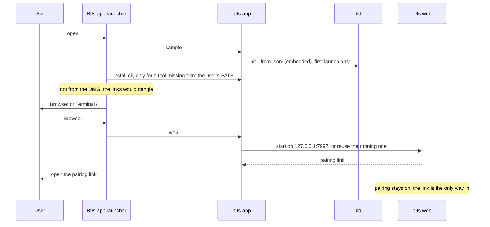

## Context

b9s installs through Homebrew, a curl script, Linux packages or `go install`, and
each of them assumes the reader has a terminal open and already runs `bd`. That
fits a developer who works beside coding agents. It shuts out the other half of
the conversation about the work: a product owner who plans, reviews and
prioritises, and who will not install two command-line tools to look at a board.

`b9s web` already gives that person a browser view of the same issues, and since
ADR 0025 b9s reads embedded Dolt projects through `bd`, so a project needs no
Dolt server. What was missing is a way in that needs neither a terminal nor a
project of one's own.

## Decision

**Publish a DMG holding B9s.app: a script-based app bundle that carries universal
`b9s` and `bd` binaries, creates an editable sample project in `~/B9s` on first
launch, links both commands into `/usr/local/bin` without a question unless the
user already has them, and opens the project in the browser (`b9s web`) or in
Terminal (`b9s`).**

## Options considered

- **A script app bundle in a DMG** (chosen): no Xcode project, built by one
  shell script from what the repo already has, testable with stubs. Dialogs are
  plain `osascript`, which looks basic.
- **A `.pkg` installer inside the DMG**: installs the commands without a
  password prompt later. But it runs as root, so it cannot create a sample
  project in the user's home cleanly, and an installer is a heavier step for a
  product owner than dragging an app.
- **A native Swift app with a menu bar item**: the best experience, but a
  second language and toolchain in a Go repository, for a first version whose
  worth is not yet known.
- **Homebrew cask only**: still needs a terminal and Homebrew, which is the
  barrier this decision removes.

## Consequences

- Beads is not optional for b9s, so the app installs `bd` instead of asking.
  A `bd` the user already has wins, even an older one: the app runs its own
  copy, and a second `bd` on `PATH` would make which one runs depend on `PATH`
  order.
- A product owner can go from download to an editable board without a
  terminal, and a developer gets working `b9s` and `bd` commands from the same
  download. Both look at the same issues through the same `bd` writes.
- The app pins a bd release (`BD_VERSION` in `build-dmg.sh`). Raising it means
  running the bd contract test first, as for the README's tested range.
- An unsigned build makes the user confirm the first open. A release DMG needs
  a Developer ID certificate and notarization, which the build supports through
  environment variables but which the project does not hold yet.
- The bundled b9s should not replace itself with `b9s --update`, because that
  would break the bundle's signature; updates come as a new DMG.
- Re-evaluate if product owners use the browser view enough to want it without
  the dialogs (a menu bar app that keeps `b9s web` running), or if the DMG
  needs a Linux or Windows counterpart.
