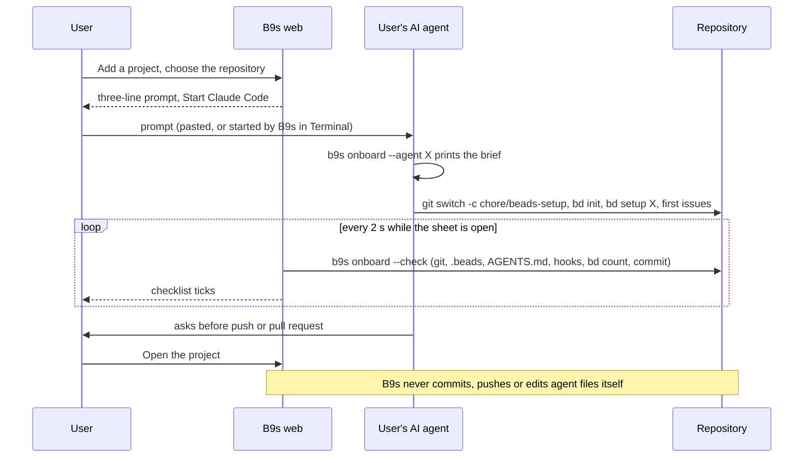

## Context

B9s.app (ADR 0056) opens a sample project. The next question every new user has
is how to get their own work into it. Setting up Beads in a repository is more
than `bd init`: the repository needs instructions that tell coding agents to use
`bd`, agent hooks that run `bd prime`, a first set of issues, and a commit on a
branch the team can review. Most of that is judgement about the repository
(which agent the team uses, what the first issues are, where the instructions
go), and the person adding the project is often a product owner who will not do
it by hand in a terminal.

The people we build for already have an AI coding agent (Claude Code, Codex,
Cursor) that can read a repository, run commands and ask before it pushes. What
they lack is someone telling the agent exactly what to do, and a way to see that
it was done.

## Decision

**B9s leads and the user's own AI executes. `b9s onboard` prints a step-by-step
brief for the agent and checks the result; the web app hands the agent a
three-line prompt that runs it, and shows a checklist that ticks itself off as
the work lands in the repository. B9s itself only ever runs `bd init`: for a
plan without code, or when the user asks it to skip the AI.**

- `b9s onboard [--agent claude|codex|cursor|other] [dir]` prints the brief;
  `--check` prints the checklist and exits 0 only when the setup is complete;
  `--json` gives the same to a program; `--prompt` prints the short prompt.
- The brief creates the branch **before** `bd init`, because bd 1.3.1 commits
  its own setup on whatever branch is checked out.
- The web routes live under `api/onboard/`. Those that open a window on the
  computer (the folder picker, Terminal, starting an agent) refuse a browser that
  is not on loopback; all of them refuse a `--public` server.
- A plan without code is an embedded Beads project in `~/B9s/<name>` (the
  projects root), created by B9s with `bd init`.
- The app's first launch asks once: Quit, Open the sample, or Add your
  project. Both open the browser view (Add opens `#/add`); later launches skip
  the question. Terminal users reach `b9s` through Open in Terminal on any
  project, so the launcher no longer asks Browser or Terminal.

## Options considered

- **The user's AI does the setup, B9s briefs and checks** (chosen): the agent
  already knows the repository and the team's conventions, and asks before it
  pushes; B9s stays out of the repository's history. Costs: the user needs an
  agent, and the result depends on how well the agent follows the brief, which
  the checklist makes visible.
- **B9s runs the whole setup itself**: no agent needed, but B9s would have to
  decide where instructions go, which hooks to install and what the first issues
  are, and commit to the user's repository. That is judgement a desktop app
  makes badly and a team will not trust.
- **Documentation only**: a page of commands to run. It is what exists today,
  and it is what a product owner does not do.

## Consequences

- Adding a repository works for anyone who has Claude Code, Codex or Cursor;
  others copy the prompt into whatever AI they use, or ask a teammate with the
  message the sheet copies.
- The checklist is the contract: if bd changes what setup means, `internal/onboard`
  changes, and the brief, the CLI check and the web checklist follow together.
- B9s needs no write access to git and holds no credentials for it.
- Re-evaluate when bd ships its own guided setup that covers instructions,
  hooks and the first issues, or when most users turn out to have no agent.
