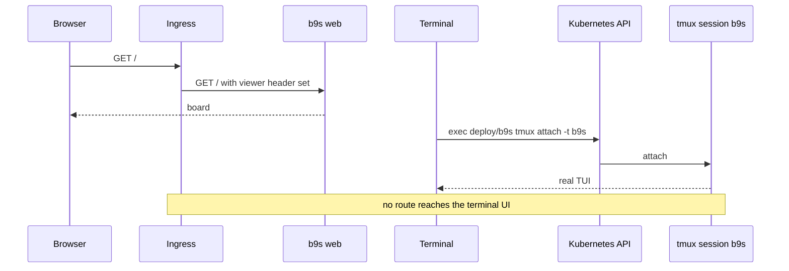

## Context

A task preview served the terminal UI to a browser through ttyd. ADR 0005 added
a touch shell that bridged mobile key presses into the shared tmux session, and
ADR 0006 routed that shell through a private tailnet path. Reviewing the TUI in
a browser terminal is not the same as reviewing it in a terminal: key handling,
resize and colour differ, and the touch shell was a third interface to keep
working. The web board (ADR 0019) had no preview at all, so a change to it
reached review untested.

The people and agents who review a preview already hold a credential for the
preview namespace. A terminal attached through the Kubernetes API is the real
TUI in a real terminal, with no extra listener in the Pod.

## Decision

**The preview URL serves `b9s web`, and the TUI runs in a detached tmux session
that a reviewer attaches to with `kubectl exec`.** The board runs in
trust-header mode (ADR 0021). The cluster supplies the header name and the
accepted viewer as `PREVIEW_VIEWER_HEADER` and `PREVIEW_VIEWER`, with no
defaults, and its ingress sets that header on every request.
`PREVIEW_INGRESS_MIDDLEWARE` accepts a comma-separated list so a cluster can
chain its access restriction and its header Middleware.

## Options considered

- **Board on the URL, TUI by `kubectl exec`** (chosen): the TUI is tested in a
  real terminal, the board gets a preview, and the Pod exposes no terminal over
  HTTP. Reviewers need `pods/exec` in the preview namespace.
- **Keep ttyd and add the board on another path**: two browser surfaces, and
  the TUI is still reviewed through a browser terminal.
- **sshd in the preview Pod**: a real terminal without Kubernetes credentials,
  but it adds a daemon, host keys and a key distribution problem for a Pod that
  lives for one task.

## Consequences

- Supersedes ADR 0005 and ADR 0006. The touch shell, its key endpoint, the
  tailnet route and both ttyd listeners are gone.
- Phone review of the TUI is no longer possible. The board serves phones.
- Anyone who reaches the board's port from inside the cluster can send the
  header themselves. The NetworkPolicy admits only the ingress controller's
  namespace and the runner namespace, and the viewer is a review identity, not
  a person's account.
- `preview-verify` fails unless both the board and the tmux pane answer.
- Revisit if reviewers without Kubernetes credentials must open the TUI.
