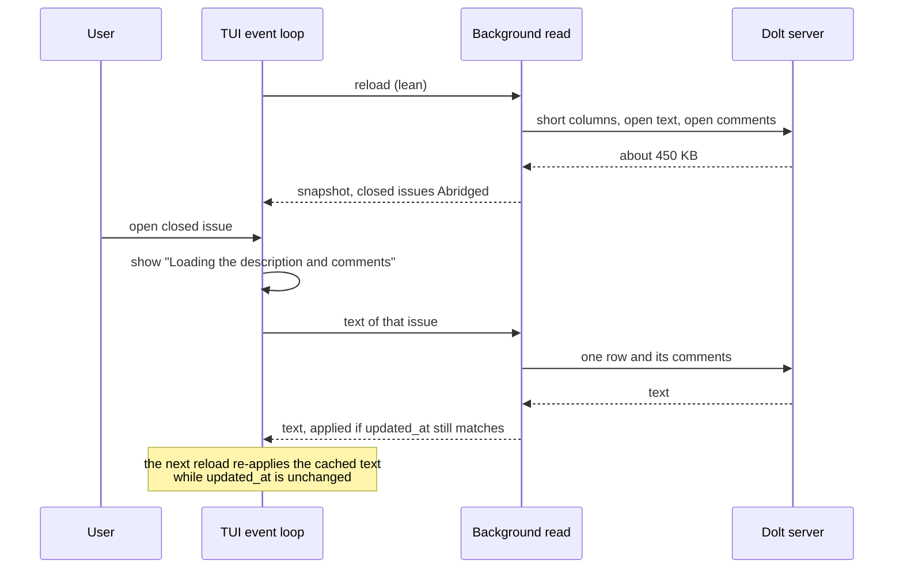

## Context

The TUI rereads the whole project from the shared Dolt server on every change.
Agents write a progress comment every minute or so, so on a busy project a
reload starts every few seconds, and each one carried every issue's
description, design, notes, acceptance criteria and every comment. On the
`b9s` database that was 2.9 MB per reload, against 233 KB for the columns the
tree, the board, filters and sorting read. Most of the difference is the text
of closed issues, which a user opens rarely. With dozens of b9s instances
behind one SSH tunnel, that traffic is what made the tunnel, and b9s with it,
slow (docs/plans/2026-10-18-responsive-tui-behind-shared-tunnel.md).

Plain search matches ID, title and labels only (ADR 0002, 0004), so no list
view needs the text of an issue it does not show.

## Decision

**The TUI reads a lean snapshot from a Dolt server: every issue's short
columns, labels and dependencies, plus the text and comments of issues that
are not closed and of epics. Other issues arrive with `Issue.Abridged` set,
and the TUI loads one issue's text when it shows, copies, edits or exports
that issue.**

The rules that keep this safe:

- **Abridged means unknown, not empty.** Every action that shows, copies or
  writes an issue's text goes through `Model.wholeIssue`, which returns the
  issue with its text or starts the load and says so in the status line. The
  edit form refuses an Abridged issue in `openEditModal` itself, because saving
  its empty description would erase the real one.
- **Fetched text is keyed by `updated_at`.** A reload that brings a later
  `updated_at` drops the cached text; the next look loads it again.
- **One request per issue at a time,** stamped with the project generation, and
  bounded by a 30 second timeout. A failed load is shown in the detail pane and
  retried after the next reload, not in a loop.
- **The lean read is opt-in.** `OpenTarget.Lean`, `LoadLeanFromSource` and
  `OpenProjectLean` are used by the TUI only. `b9s web`, `b9s attach` and every
  other caller keep the whole read, and SQLite, JSONL and embedded Dolt sources
  are always read whole: they are local, so their text costs no network.

## Options considered

- **Lean snapshot with on-demand text** (chosen): about 450 KB per reload on
  `b9s` instead of 2.9 MB, and no visible gap for open issues. Costs one round
  trip when a closed issue is opened, and every text reader has to go through
  one guard.
- **Lean snapshot with no prefetch**: smallest reload, but every issue opened
  waits for the network, including the open ones people work on.
- **Keep the whole read and only make it asynchronous** (bd-mlet.3, done):
  keeps the UI responsive, but leaves the tunnel carrying 2.9 MB per change for
  every instance.
- **Read through `bd serve` over HTTP** (b9s#11): moves the cost, it does not
  remove it. Kept as a separate spike (bd-mlet.8).

## Consequences

- Reloads move about a sixth of the bytes, so the tunnel's load from b9s drops
  in the same ratio.
- The list view's comment count shows nothing for an Abridged issue, because
  its comments are unknown.
- A new feature that reads `Description`, `Notes`, `Design`,
  `AcceptanceCriteria` or `Comments` must take its issue from
  `Model.wholeIssue`. `TestOpenEditModalNeverOpensOnAnAbridgedIssue` and the
  other tests in `pkg/ui/issue_text_test.go` hold the existing paths to that.
- A search form that matches on text would have to load the closed set first.
  None exists today.
- Re-evaluate if the TUI gains full-text search, or if reads move to an HTTP
  API that serves text per issue anyway.
