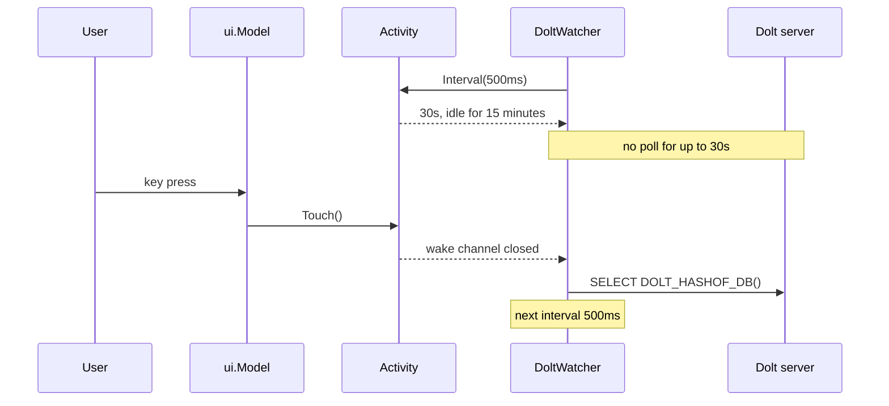

## Context

Every open TUI asks the shared Dolt server for `DOLT_HASHOF_DB()` every
`refresh.poll_interval`, 500 ms by default, through an SSH tunnel. Sessions
stay open for days in background tabs and tmux windows, so most of that load
comes from screens nobody is reading. Each hash change also starts a reload
(ADR 0060), so an idle session on a busy project rereads the project as often
as an active one. The poll is cheap for one user and adds up across many
sessions and agents on one server (bd-mlet, finding in bd-6a1l).

## Decision

**The TUI polls at `refresh.poll_interval` while the user is active, at
`refresh.idle_poll_interval` (5 s) after two minutes without a key or mouse
event or while the terminal has lost focus, and every 30 s after fifteen
idle minutes. The first input after idle makes every watcher poll at once.**

- One `datasource.Activity` per model holds the last input time and the
  focus state. Every watcher the model starts follows it, so the project
  watcher and the all-projects watcher back off together.
- An idle interval is never shorter than the configured active interval.
- The backoff is opt-in on the watcher. `b9s web` has no keyboard to be idle
  at and keeps the fixed interval.
- Focus comes from terminal focus reports (`tea.WithReportFocus`). A
  terminal that sends none counts as focused, so only the input timer applies.

## Options considered

- **Backoff by input and focus** (chosen): the server load follows what
  people read. Costs a delay of up to 30 s before an idle screen shows other
  writers' changes, and nothing once the user returns, because the first key
  polls at once.
- **A slower fixed interval**: simple, but every active user sees changes
  later, and the delay is paid exactly when someone is reading.
- **Push from the server** (a `bd serve` stream, b9s#11): removes polling
  altogether, but needs a server component that does not exist yet. Backoff
  is still right for whatever polling remains until then.
- **Stop polling entirely while idle**: the first key would then show a
  snapshot that can be hours old until the reload returns, and a status
  screen left open on a wall display would never update.

## Consequences

- An idle session issues one hash query per 30 s instead of two per second.
- A screen left open without input lags other writers by up to 30 s. Users
  who want a live wall display can set `idle_poll_interval` to the active
  interval, which makes the deep idle step the only backoff left.
- The first key after idle reaches the old snapshot, and the reload it starts
  lands a moment later. The cursor and selection survive that reload as they
  survive any other.
- Re-evaluate when a push channel such as `bd serve` replaces the hash poll.
