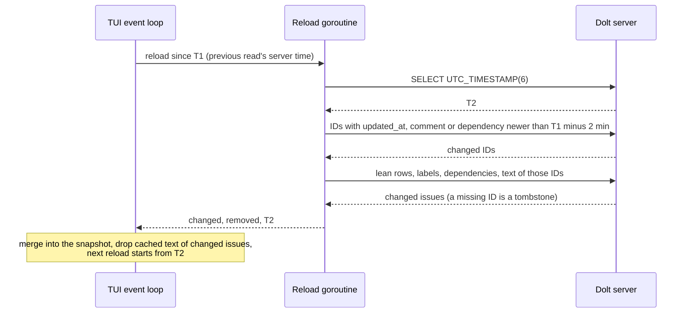

## Context

Every Dolt commit makes the TUI reload the project. ADR 0060 made each
reload lean, but it still reads every issue's short columns, labels and
dependencies, and the text and comments of every open issue and epic. On a
project where agents comment every minute, that is hundreds of rows through
the SSH tunnel to change one. The epic that ADR 0060 belongs to (bd-mlet)
planned one ADR for both steps. ADR 0060 was already active when this step
landed, so this decision has its own record.

Facts measured on the shared server before the design:

- The server clock is UTC and timestamps are stored as UTC `DATETIME`.
- A comment usually moves its issue's `updated_at`, but not always: 36 of
  1067 comments did not.
- `dependencies` has `created_at`. `labels` has no timestamp, and a removed
  dependency or label leaves no row behind.

## Decision

**A reload asks the server for the IDs that changed since the previous
read's server time, reads only those issues lean, and merges them into the
snapshot on screen. A full read still runs on the first reload, after a
failed read, on Ctrl-R or F5, after 20 incremental reads, and five minutes
after the last full read.**

- The changed IDs come from `issues.updated_at`, `comments.created_at` and
  `dependencies.created_at`, so a comment that leaves `updated_at` alone
  still reaches the screen.
- The start point reaches two minutes before the previous server time. A
  writer whose clock runs behind the server's stamps rows in the past, and
  merging a row twice is harmless.
- More than 500 changed IDs read in full: past that, one full read is cheaper
  than a long `IN` list.
- A changed ID that the lean read does not return is a tombstone or a deleted
  row and leaves the snapshot.
- Text fetched on demand for a changed issue is dropped, because its row can
  look the same while its comments differ.
- Sources other than a Dolt server read in full each time, as before.

## Options considered

- **Changed-ID query plus a periodic full read** (chosen): one extra small
  query per reload, with no schema change and no writer cooperation. Label
  changes and removed dependencies that move no timestamp wait for the next
  full read, at most five minutes or 20 reloads later.
- **Dolt diff tables (`dolt_diff_<table>` from the last read's root to
  `WORKING`)**: exact, including deletes and label changes, and they can see
  the uncommitted writes `bd` leaves in the working set. Not chosen now: the
  read would have to keep a root per table and query Dolt system tables whose
  cost through the tunnel was not measured. It is the upgrade path if the
  late label changes below prove to matter.
- **Ask `bd` to bump `updated_at` on every child write**: the cleanest key,
  but it changes an upstream tool b9s does not own, and existing rows would
  still need the fallbacks above.

## Consequences

- A reload on a busy project reads a handful of rows instead of the open
  half of the project, so the tunnel carries the change and not the snapshot.
- A label added or removed without a timestamp change shows up late, at the
  next full read. Ctrl-R forces one at once.
- The snapshot on screen is now state carried between reloads. Any failure
  resets the start point so the next read rebuilds it from scratch.
- Re-evaluate if `bd` starts committing every write (diff tables become
  exact) or stamps label writes.
