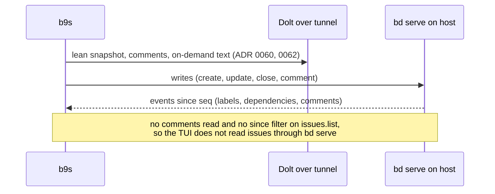

## Context

b9s reads a Dolt server over the MySQL protocol through an SSH tunnel and
writes by running `bd`. Through the tunnel each round trip costs tens of
milliseconds and each `bd` process pays its own startup. Issue
[b9s#11](https://github.com/vanderheijden86/b9s/issues/11) asks whether
consuming `bd serve` over HTTP would remove those costs. ADRs 0060 to 0062
already cut what each reload reads. The open question was whether `bd serve`
could replace the SQL reader as well as the `bd` subprocesses.

The spike (bd-mlet.8) ran bd 1.3.2-rc.2 `bd serve` on a local scratch copy
of the b9s database (1690 issues) and measured:

| Probe | Result |
|---|---|
| `issues.list?status=all&limit=0` | 3.5 MB, about 53 ms |
| same with `brief=true` | 1.08 MB, 21 fields, no `due_at`, no text |
| `issues.list?status=open` | paged by default, 59 KB, about 20 ms |
| `issues.get` | about 11 ms locally, 17 to 23 ms on the host |
| comments read | none: `GET issues/{id}/comments` is 404, `get` omits comments |
| list filters `since`, `updated_after`, `fields` | rejected |
| `--readonly` | refused |
| workspace under `/tmp` | refused as an unsafe location |
| events journal: `bd comments add` | recorded, op `comment`, full issue and comment |
| events journal: `bd label add` | recorded, op `update`, issue with labels |
| events journal: raw `bd sql` UPDATE | not recorded |
| journal paging | `GET /v0/beads/events?since=<seq>`, returns `head` |

Through the laptop tunnel a forwarded `bd serve` answered in 9 to 13 s
because the process ran on the laptop side of the tunnel. On the host it
answered in 100 to 130 ms over a dedicated forward.

## Decision

**b9s keeps SQL as its read path. `bd serve` becomes a later, optional
source for writes and for a change feed, run on the database host, never
on the laptop side of the tunnel.**

## Options considered

- **Keep SQL reads, add bd serve later for writes and events** (chosen).
  SQL already gives comments, the project catalog and the lean text that
  ADR 0060 needs. The journal fills ADR 0062's gap for labels and removed
  dependencies once it runs on the host. It adds no new process today.
- **Replace the SQL reader with bd serve now.** It cannot show comments,
  has no `due_at` in the brief list, and has no change filter on the list,
  so every reload would read the full list again. It also serves one
  database per process, so the project switcher needs one server per
  project.
- **Run bd serve on the laptop.** Measured at 9 to 13 s per request through
  the tunnel. That is slower than the SQL path it would replace.

## Consequences

- b9s needs no new process or deployment for this epic.
- A host deployment of a supervised `bd serve` with its own forward is a
  change to shared infrastructure and waits for the owner.
- A `SourceTypeBeadsHTTP` source becomes worth building when upstream adds
  a comments read, a since filter on `issues.list`, `due_at` in `brief`,
  and a read-only mode. Those asks are drafted in Beads for the owner.
- The journal misses raw SQL writes, `bd dolt pull` and merges, so the
  periodic full read of ADR 0062 stays even with a change feed.
- Re-evaluate when upstream ships the asks above, or when the host runs
  `bd serve` for other consumers.
