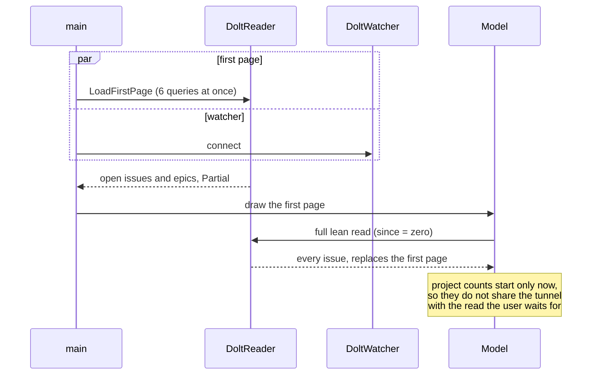

## Context

b9s read the whole lean snapshot (ADR 0060) before it drew anything. Through
the SSH tunnel to the shared Dolt server that read ran seven queries in turn,
each opening or reusing one of at most two connections, and then the Dolt
watcher opened a connection of its own. Measured on the `b9s` database (1698
issues, 252 of them read whole) on 2026-10-18:

| Step | Time through the tunnel |
|---|---|
| Open a connection and ping | 1.6 to 3.1 s |
| Lean issue rows, all issues | 2.2 to 2.6 s |
| Lean issue rows, not closed | 0.5 s |
| Whole text of 252 issues | 1.4 to 3.1 s |
| Labels, dependencies, comments | 0.35 to 1.3 s each |

The tree's first screen only needs the issues that are not closed and the
epics: closed issues sit under a filter or below their open siblings. Those
are exactly the issues the lean read carries whole, so a read restricted to
them has everything the first screen draws.

## Decision

**Startup reads the first page only (issues that are not closed, and every
epic, each exactly as the full lean read has it), draws it, and reads the rest
in full right after. The queries of one lean read run at the same time, and
the watcher connects while the first page is read.**

- `DoltReader.LoadFirstPage` restricts every query of the lean read to the
  first page. `OpenProjectFirstPage` uses it and sets `OpenedProject.Partial`.
  Only a Dolt server can be partial: every other source is read whole at disk
  speed.
- `Model.WithPartialSnapshot` makes `Init` send `firstPageShownMsg`, which
  starts the full read through the ordinary reload path. Its reply replaces
  the snapshot as every full read does.
- A project switch opens with `OpenProjectFirstPage` too. The switch only
  checks that the project opens and then reloads it in full, so the cheaper
  read shortens the wait and changes nothing else.
- The reader's pool holds `leanReadQueries` (6) connections, one per query of
  a lean read.

## Options considered

- **First page, then the full read** (chosen): the first screen arrives after
  one parallel round of queries. Closed issues appear a few seconds later.
- **Run the queries in parallel, keep one full read**: removes the sum of
  round trips, but the issue rows of every issue (2.2 to 2.6 s) stay on the
  critical path.
- **Page by screen height (LIMIT n)**: the tree needs every open issue to
  place parents, children and blocked markers, so a row limit draws a wrong
  tree.
- **Cache the last snapshot on disk and draw it first**: the fastest first
  screen, but it shows data that may be stale and adds a cache to invalidate.
  Worth reconsidering if the first page itself grows slow.

## Consequences

- Median time from start to the first issue on screen, in tmux, alternating
  builds: 10.6 s before (12 runs), 4.1 s after (9 runs). Both spread widely
  because opening a connection through the tunnel varies from 1 to 3 s.
- For a few seconds after startup, closed issues are missing: the closed
  count, a `status:closed` filter and the board's closed column are empty
  until the full read lands. The footer shows `reloading` meanwhile.
- The first page and the full read are two reads, so startup sends more bytes
  in total. Only the first is on the path the user waits for.
- Six connections per reader is three times the earlier two. The server
  accepts them, but a project with many b9s users multiplies them.
- Re-evaluate if the open issues alone take seconds to read, or if the closed
  issues are needed on the first screen (a default filter on closed work).
