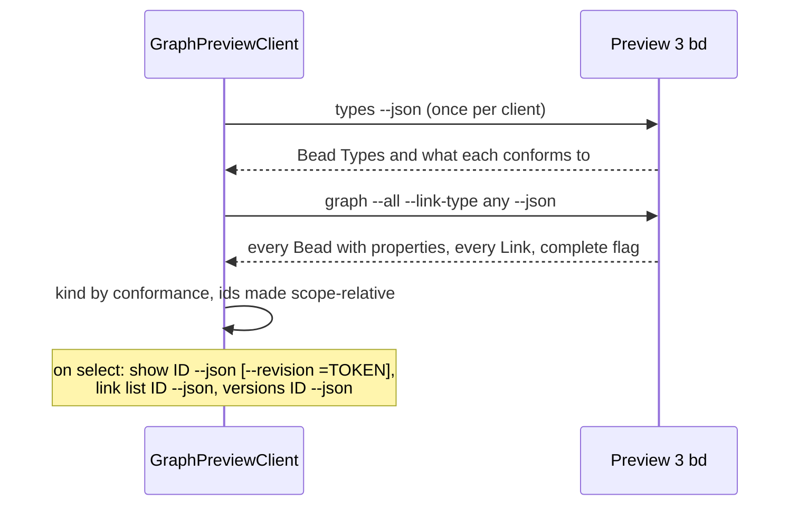

## Context

ADR 0045 probes bd's help output for the `preview-v2` dialect and reads its
workspaces through `list --format records-json --all`, `links ID` and
per-component `graph` traversals. Graph-mode Preview 3 (donnabox/beads
`210f8dad`, reporting `bd version 1.3.0`) breaks each of those, observed
against a fresh `bd init --graph-mode link` workspace on 2026-11-06:

- `metadata.json` carries `graph_schema_version: 11` and a new
  `graph_scope_url`. b9s capped the schema at 6, so it read as not enabled.
- There is no `links` command. Incident Links come from `link list ID`.
- `list --format records-json --all` returns Issues only. Memory Beads appear
  in `memories` summaries, which carry no body.
- Every id, Type and Link endpoint is an absolute URL under the scope, and
  Memory ids are paths such as `projects/demo/capabilities/x`. Cutting an id
  at its last slash, as preview-v2 ids allowed, leaves `x`.
- A Bead's Type no longer names its kind. `specification` and `policy` are
  Memory Types, `task` is an Issue Type, and a workspace may install more.
- Records carry `revision` where preview-v2 had `version`, a retained version
  is read with `show ID --revision =TOKEN`, and `versions` numbers versions
  with `local_revision`.
- `graph` follows only Dependency Links unless given `--link-type any`.

b9s never reads graph tables directly, only bd's JSON, so the schema number
matters only for which bd can open a workspace: Preview 3 bd refuses any
schema but its own, and preview-v2 bd predates schema 7.

## Decision

**Add a `preview-v3` dialect. Read its inventory with one
`graph --all --link-type any --json`, classify Beads with `types --json`, and
hand out ids relative to the workspace scope.**

- **Probe.** After `versions --help` and a `memories --help` that mentions
  `records-json`, `links --help` exiting 0 means `preview-v2`, and otherwise
  `link list --help` exiting 0 means `preview-v3`. The answer is cached per
  binary as before.
- **Schema.** Metadata up to schema 11 passes the workspace check. A
  `preview-v2` bd with a schema above 6, or a `preview-v3` bd with one at or
  below 6, is `unsupported`, with a reason naming the bd the workspace needs.
- **Inventory.** The whole-workspace graph carries Memory bodies and Issue
  records with every Link Type, so no per-component traversal runs. A result
  whose `traversal.complete` is false is refused, as `hasMore` is for
  preview-v2: bd bounds it at 1000 Beads and 1000 Links.
- **Kind.** A Bead is a Memory when its Type conforms, through any chain, to
  the scope's `memory` Type, and an Issue when it conforms to `issue`. The
  Type list comes from the store, never from Type names.
- **Ids.** The client strips the scope from every id, Type and Link endpoint,
  and the graph keeps the remaining path whole. The `blocks` Link Type maps to
  a scheduling dependency, as `preview-blocks-v1` does.
- **bd location.** `B9S_BD` names the bd to run in place of the one on `PATH`.
  A `B9S_BD` naming a missing file leaves bd not found rather than falling
  back to `PATH`, whose bd may speak another dialect.

## Options considered

- **One whole-workspace graph read** (chosen): one bd process returns bodies,
  Issues and all Links, and reports whether the result is complete.
- **`memories --all --details`, `link list` and `list --json` together**: what
  the requesting rig observed working. It takes three processes, and the
  summaries carry only an excerpt, so a Memory's body would need one `show`
  per Memory.
- **Classify Beads by Type name**: no extra call, but Memory Types are
  installed per catalog (`specification`, `requirement`, `policy`, ...) and a
  name list would go stale with the next catalog.
- **Keep absolute ids**: no translation, but the views and the web graph would
  show scope URLs, and Issue ids would no longer match the ids bd prints.

## Consequences

Both dialects work from one b9s binary, and the probe still never opens a
database. A Preview 3 workspace over 1000 Beads or Links is refused until bd
offers paging for `graph --all`. The `types --json` call opens the workspace,
which is acceptable here because it runs only after the workspace and the
probe both said ready, inside the read it serves. The real captures in
`internal/datasource/testdata/preview3` pin the parsers. Re-evaluate when
Preview 3 changes its JSON or upstream defines a capability token (ADR 0045).
