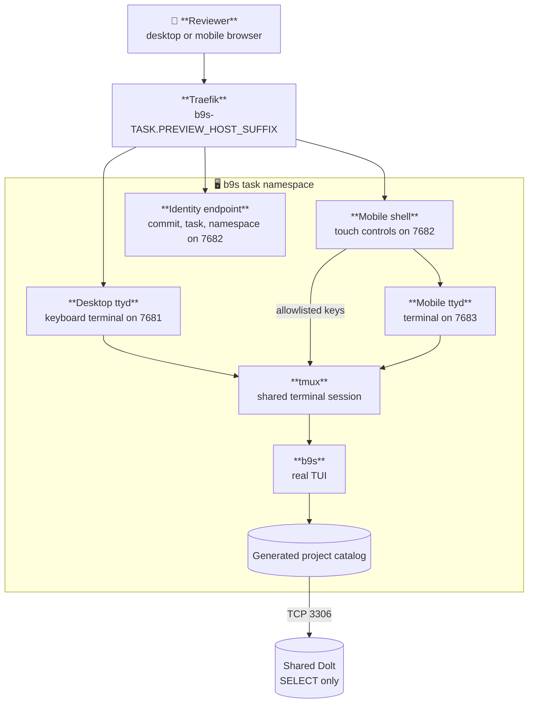

# Browser-accessible Kubernetes previews

The b9s preview runs the real terminal UI through ttyd. A reviewer can use the
desktop terminal with a keyboard or open the mobile shell at `/b9s/` for touch
navigation. The preview reads every accessible Beads database through a
database-enforced SELECT-only account. It does not seed fixture tickets or hold
a write-capable Beads credential.

Status: active

## Contents

- [Interface](#interface)
- [Deployment values](#deployment-values)
- [Runtime shape](#runtime-shape)
- [Mobile navigation](#mobile-navigation)
- [Namespace and access boundary](#namespace-and-access-boundary)
- [Image delivery](#image-delivery)
- [Clickable URL](#clickable-url)
- [Ingress access](#ingress-access)
- [Configuration](#configuration)
- [Local verification](#local-verification)
- [Recovering a stale browser session](#recovering-a-stale-browser-session)
- [Cleanup](#cleanup)

## Interface

The deployment verifier uses five repository-owned commands:

```text
scripts/preview/preview-build   TASK_ID COMMIT_SHA
scripts/preview/preview-deploy  TASK_ID COMMIT_SHA
scripts/preview/preview-status  TASK_ID COMMIT_SHA
scripts/preview/preview-verify  TASK_ID COMMIT_SHA
scripts/preview/preview-destroy TASK_ID COMMIT_SHA
```

Every command requires a full lowercase commit SHA and refuses a different HEAD
or uncommitted source changes. The only worktree exceptions are untracked
`.codex-tmp/` harness files, an unstaged modification of `.beads/.local_version`
(Beads' local upgrade-notification state), and an untracked `.beads.gate.lock`
(the local Beads coordination lock). These artifacts remain in place and are
excluded from the preview image build context by `Dockerfile.dockerignore`.
Staged changes, Beads issue/configuration edits, and other untracked files still
block delivery. Do not reset, delete, or hide files to satisfy the guard.

The default kubeconfig is `/mnt/secrets/preview/preview.kubeconfig`, a
project-scoped credential the cluster mounts into the deploying Pod. The
default context is `preview`.

## Deployment values

This repository does not know the cluster it deploys to. Every value that names
a platform object comes from the environment, supplied by whatever runs the
preview (a software factory, or an operator's shell). The commands stop before
any cluster access when a required value is missing.

| Variable | Required | Meaning |
| --- | --- | --- |
| `PREVIEW_HOST_SUFFIX` | yes | DNS suffix of preview hosts |
| `PREVIEW_INGRESS_MIDDLEWARE` | no | Traefik Middleware reference (`namespace-name@kubernetescrd`) on every preview Ingress; empty renders none |
| `PREVIEW_LABEL_DOMAIN` | yes | Prefix of the namespace labels the cluster's policies match |
| `PREVIEW_RUNNER_NAMESPACE` | yes | Namespace whose Pods may reach the preview |
| `PREVIEW_WORKLOAD_ROLE` | yes | ClusterRole bound inside the preview namespace |
| `PREVIEW_DEPLOYER_SA` | yes | `namespace/name` of the deploying ServiceAccount |
| `PREVIEW_READER_REF` | yes | Name of the Secret holding the read-only database credential |

`PREVIEW_DEPLOYER_SA` and `PREVIEW_READER_REF` may contain `{project}`, which
the scripts replace with `b9s`. A cluster that serves several projects can then
set one template for all of them.

## Runtime shape



The image bakes `/app/.commit-sha`. Deployment supplies only the task and
namespace, so an edited environment variable cannot make one image claim to be
another commit. `preview-verify` reads `/__preview` through the Service and
compares all three identity fields with the requested preview.

## Mobile navigation

The mobile shell keeps the terminal visible above two touch-control rows. The
project row pins previous and next project-page buttons around a horizontally
scrollable strip containing `All` plus project keys `1` through `9`. The
navigation row provides up, down, previous page, next page, open and back
actions. Each button sends one allowlisted key through the CGI endpoint to the
shared tmux session, so it does not depend on a mobile browser synthesizing
keyboard events.

The desktop URL remains unchanged. Append `/b9s/` to open the mobile shell.

## Namespace and access boundary

`TASK_ID` becomes `b9s-TASK-SLUG`. The namespace carries these labels, with
`PREVIEW_LABEL_DOMAIN` as the prefix:

```text
PREVIEW_LABEL_DOMAIN/preview=true
PREVIEW_LABEL_DOMAIN/project=b9s
PREVIEW_LABEL_DOMAIN/task-id=TASK_ID
PREVIEW_LABEL_DOMAIN/commit-sha=COMMIT_SHA
```

The deployer is expected to hold only namespace lifecycle and constrained bind
permissions. The first namespaced object is a RoleBinding of
`PREVIEW_DEPLOYER_SA` to `PREVIEW_WORKLOAD_ROLE`. The cluster's admission policy
decides where that binding is allowed. LimitRange, ResourceQuota and
NetworkPolicy ship with every preview.

The credential is project-scoped, not lane-scoped. One b9s lane can still reach
another b9s lane's preview. It cannot bind or deploy in a sibling project's
namespace or in `default`.

Redeploying the same task with another SHA updates the namespace's
`commit-sha` label and kubectl's
`kubectl.kubernetes.io/last-applied-configuration` annotation. The cluster's
policy must allow these metadata updates in labelled `b9s-*` preview
namespaces. Namespace creation permission alone is insufficient. This
repository does not widen that policy.

`preview-deploy` first applies the rendered Namespace with `--dry-run=server`.
An admission or authorization failure stops before any workload is applied and
records the API error in `namespace-policy.log` in the evidence directory.
This catches metadata policy regressions even when the existing namespaced
RoleBinding still allows workload changes. The preflight does not grant access
or make the subsequent multi-resource apply atomic.

Before the first deployment, an operator runs
`scripts/preview/preview-provision-reader TASK_ID`. The command finds databases
that contain an `issues` table, grants the read-only identity named by
`BEADS_DOLT_READ_USER` `SELECT` on each database individually, proves a no-op
`UPDATE` is denied, and only then writes the `PREVIEW_READER_REF` Secret into
the task namespace. Database names are enumerated because Dolt does not
reliably enforce wildcard database grants. Re-run the command after adding a
Beads database.

The Secret exposes only `B9S_DOLT_HOST`, `B9S_DOLT_PORT`,
`B9S_DOLT_READ_USER`, and `B9S_DOLT_READ_PASSWORD`. The NetworkPolicy permits
database traffic only on TCP 3306.

## Image delivery

Inside a runner Pod, `preview-build` uses the BuildKit service and pushes the
immutable SHA tag to the in-cluster registry:

```text
registry.registry.svc.cluster.local:5000/b9s-preview:COMMIT_SHA
```

On a workstation it uses Docker. Set `B9S_PREVIEW_PUSH_REGISTRY` when the
registry is reached through a local port-forward but the cluster must pull the
service-name image reference.

## Clickable URL

The URL is:

```text
http://b9s-TASK-SLUG.PREVIEW_HOST_SUFFIX:B9S_PREVIEW_INGRESS_PORT
```

Use a suffix under a domain you resolve yourself, such as a reserved `.test`
name answered by a local resolver. Do not use nip.io or sslip.io: a label
ending in digits can be read as part of the embedded address and route to an
unrelated public IP.

For phone access, set `B9S_PREVIEW_TAILSCALE_HOST` to the workstation's
MagicDNS name before deploying. The manifest adds only `/b9s`, `/b9s/terminal`
and the allowlisted key endpoint to that host, so an existing application at
the host root remains unchanged. Tailscale Serve forwards tailnet HTTPS to the
local Traefik listener:

```sh
tailnet_host="$(tailscale status --json | jq -r '.Self.DNSName | rtrimstr(".")')"
export B9S_PREVIEW_TAILSCALE_HOST="$tailnet_host"
tailscale serve --bg --yes http://127.0.0.1:8081
scripts/preview/preview-deploy bd-b6jw "$sha"
```

The mobile URL is `https://TAILNET_HOST/b9s/`. Tailscale Serve is private to
the tailnet. Do not use Funnel for this preview.

## Ingress access

A preview serves a writable terminal. On a cluster whose ingress is publicly
reachable, set `PREVIEW_INGRESS_MIDDLEWARE` to a Traefik Middleware that admits
only trusted traffic, and have admission refuse a preview Ingress without it.
How a reviewer then reaches the preview (a port-forward, a VPN) is the
cluster operator's choice and is documented with the cluster, not here.

Traefik answers 404 for a route that names a Middleware the cluster does not
define. Leave the variable empty on a cluster without one.

## Configuration

Tuning knobs, all optional:

| Variable | Default | Purpose |
| --- | --- | --- |
| `B9S_PREVIEW_KUBECONFIG` | `/mnt/secrets/preview/preview.kubeconfig` | Project-scoped credential |
| `B9S_PREVIEW_CONTEXT` | `preview` | Explicit kubectl context |
| `B9S_PREVIEW_REGISTRY` | `registry.registry.svc.cluster.local:5000` | Image reference used by Kubernetes |
| `B9S_PREVIEW_PUSH_REGISTRY` | same as registry | Docker push endpoint |
| `B9S_PREVIEW_BUILDKIT_ADDR` | `tcp://buildkitd.buildkit.svc.cluster.local:1234` | Unprivileged in-cluster builder |
| `B9S_PREVIEW_INGRESS_PORT` | `8081` | Local Traefik host port |
| `B9S_PREVIEW_TAILSCALE_HOST` | empty | Optional MagicDNS hostname for the private `/b9s/` route |
| `B9S_PREVIEW_ROLLOUT_TIMEOUT` | `180` | Bounded rollout wait in seconds |
| `B9S_PREVIEW_DELETE_TIMEOUT` | `180` | Bounded namespace deletion wait in seconds |

`preview-provision-reader` reads `B9S_PREVIEW_ADMIN_KUBECONFIG` (default
`KUBECONFIG`), the required `B9S_PREVIEW_ADMIN_CONTEXT`, `BEADS_DOLT_READ_USER`
and `BEADS_DOLT_ROOT_PASSWORD`.

## Local verification

Use an admin kubeconfig only for operator testing. A lane uses the mounted
project kubeconfig instead.

```sh
sha="$(git rev-parse HEAD)"
export B9S_PREVIEW_KUBECONFIG="$HOME/.kube/config-local"
export B9S_PREVIEW_CONTEXT=local
# plus the PREVIEW_* values from "Deployment values"

scripts/preview/preview-provision-reader bd-b6jw
scripts/preview/preview-build bd-b6jw "$sha"
scripts/preview/preview-deploy bd-b6jw "$sha"
scripts/preview/preview-verify bd-b6jw "$sha"
scripts/preview/preview-status bd-b6jw "$sha"
```

The contract tests use disposable local Git repositories and placeholder
deployment values, and do not call an image builder or the cluster. They
require Bash, Git, and GNU `timeout` (`gtimeout` is also accepted), with a
five-second deadline for each boundary check:

```sh
tests/preview_contract_test.sh
```

It simulates two deployments of the same task with different SHAs and a
namespace metadata denial, asserting that denial leaves workloads untouched,
and checks that each required deployment value stops the commands when
missing. For live verification, use the scoped kubeconfig for both SHAs, check
the namespace label and last-applied annotation, and verify the image's served
identity after each rollout. Use server-side dry-run metadata patches to prove
that `default` and an outside-prefix namespace are denied. Do not substitute
`kubectl auth can-i` for admission testing: RBAC permission alone does not
evaluate the namespace policy. The operator-owned reader Secret must already
exist; a lane cannot read or provision its contents.

After deployment, exercise the exact phone controls against two populated
databases and compare the rendered totals with read-only Dolt queries:

```sh
tests/mobile_project_switch_e2e.sh \
  "https://$tailnet_host" bd-b6jw "$sha" b9s-bd-b6jw \
  "$B9S_PREVIEW_KUBECONFIG"
```

## Recovering a stale browser session

After a preview Pod is replaced, an already-open ttyd frame can remain on
`Press Enter to Reconnect` even though the deployment and tailnet route are
healthy. Confirm the two server boundaries before changing the deployment:

```sh
curl -fsS "https://$tailnet_host/b9s/__preview"
kubectl --kubeconfig "$B9S_PREVIEW_KUBECONFIG" \
  --context "$B9S_PREVIEW_CONTEXT" -n b9s-TASK-SLUG get deploy,pod
```

If the identity responds and the deployment is ready, use the mobile shell's
`Reconnect` control. The shell also reconnects when the browser returns online
or the tab becomes visible again. This preserves the shared tmux session and
does not redeploy or delete anything.

## Cleanup

`preview-destroy` derives exactly one namespace from the task ID, then checks
the project and task labels before deletion. It never uses a wildcard, label
selector, or `--all`.

```sh
scripts/preview/preview-destroy bd-b6jw "$sha"
```
